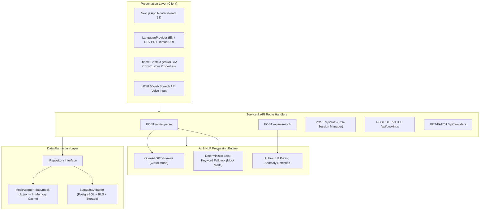

# KaamSaathi System Architecture
**University of Swat BSSE Capstone Project**  
*Habiba Khan & Laiba Khaist | Supervised by Muhammad Hamza*

---

## 1. Architectural Overview

---

## 2. Key Engineering Patterns
1. **Repository Pattern:** Decouples API handlers from underlying database implementation. When cloud keys (`NEXT_PUBLIC_SUPABASE_URL`) are omitted, the application falls back gracefully to `MockAdapter`.
2. **Deterministic NLP Fallback:** Protects against OpenAI service outages or quota exhaustion by maintaining a local dictionary of Swat regional dialects, emergency triggers, and trade synonyms.
3. **Strict Color Variable Tokens:** Hard-coded hex values inside UI components are prohibited; all components consume semantic CSS properties (`var(--bg-main)`, `var(--text-primary)`, `var(--text-secondary)`, `var(--surface)`).
